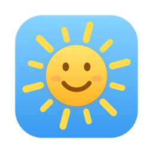

<h1 align="center">Sun kids</h1>

קורא שאלות מחלון אחד שבוחרים, ומציג לידו את התשובה. 
עונה דרך מנוי ה־Claude או ה־ChatGPT שלך.

## הורדה

| המחשב שלך | הקובץ |
|---|---|
| **Mac** (macOS 14 ומעלה) | [Sun kids.dmg](../../releases/latest/download/Sun.kids.dmg) |
| **Windows** (10 או 11, 64 ביט) | [Sun kids Setup.exe](../../releases/latest/download/Sun.kids.Setup.exe) |

מה עוד צריך: מנוי בתשלום ל־**Claude** (Pro או Max) או ל־**ChatGPT** (Plus או Pro). כל שאלה נספרת במכסת המנוי שלך.

## התקנה ב־Mac

1. פותחים את `Sun kids.dmg` וגוררים את השמש אל התיקייה Applications.
2. פותחים את Sun kids מ־Applications. בפעם הראשונה macOS חוסם אותו, כי הוא לא מה־App Store:
   לוחצים **Done**, ואז **הגדרות המערכת** ← **פרטיות ואבטחה** ← גוללים למטה ← **Open Anyway** ← סיסמת המק.
3. בחלון "ברוכים הבאים" בוחרים Claude או ChatGPT, ולוחצים לפי הסדר:
   **התקן והתחבר** (מתחברים בדפדפן), ואז **פתח הגדרות** (מדליקים את המתג שליד השמש).
4. לוחצים **התחל**. אחר כך לוחצים על החלון שממנו לקרוא שאלות, ושוב **התחל**.

## התקנה ב־Windows

1. פותחים את `Sun kids Setup.exe`. מופיע "Windows protected your PC", כי התוכנה חדשה:
   לוחצים **More info** ואז **Run anyway**.
2. בחלון "ברוכים הבאים" בוחרים Claude או ChatGPT, ולוחצים **התקן והתחבר** (מתחברים בדפדפן).
3. לוחצים **התחל**. בחלונית שבצד בוחרים את החלון שממנו לקרוא שאלות, ושוב **התחל**.

## איך משתמשים

- לכל שאלה נפתח כרטיס עם המספר שלה: "טוען תשובה…", ואחר כך התשובה.
- השאלה שמוצגת עכשיו ירוקה. חזרה לשאלה קודמת מראה את התשובה שכבר נמצאה.
- **עצור** משהה, **המשך** ממשיך, **אפס** מתחיל מחדש. **−** ממזער לגלולה קטנה.
- היסטוריה של כל השאלות והתשובות: מסמכים ← Sun kids ← היסטוריה.
- החלפה בין Claude ל־ChatGPT, או כשמשהו לא עובד: אייקון השמש ← **הגדרה**.

